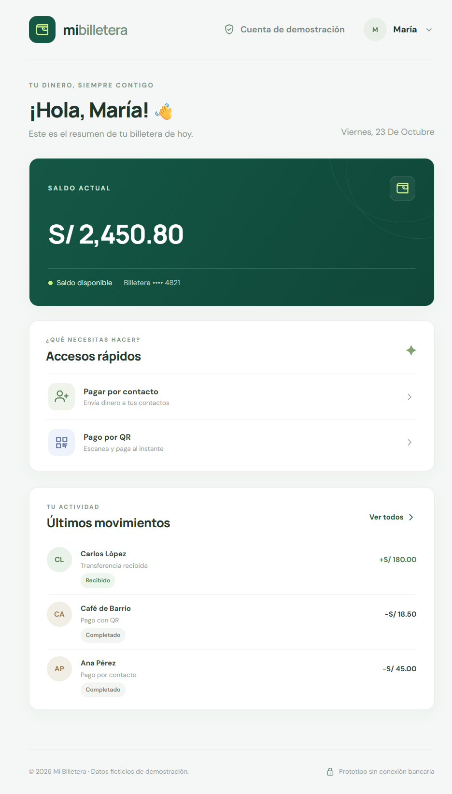

# Wallet para pagos cotidianos

Una propuesta de wallet digital pensada para que las personas puedan empezar con claridad: entender el registro, corregir sus datos y saber cuándo su cuenta está lista para acceder a pagos.

> **Estado de la demo:** se presentará el dashboard Angular de `frontend/`, con datos ficticios. No se crean cuentas reales, no se conecta con bancos y no se procesan pagos. El dashboard no incluye todavía el formulario de onboarding W1.

## La propuesta

El objetivo es reducir la fricción entre el interés por usar una wallet y el primer pago. La experiencia objetivo guía a la persona durante el registro, explica los errores de forma accionable y habilita el acceso a pagos solo cuando la cuenta cumple las condiciones definidas.

La propuesta responde a necesidades concretas:

- Saber qué información se necesita y cómo corregirla.
- Entender el estado de la cuenta y cuál es el siguiente paso.
- Llegar al flujo de pagos con expectativas claras.

## Alcance W1

W1 busca guiar el registro, validar los datos ingresados y explicar el siguiente paso según el estado de la cuenta. El flujo KYC y sus estados se detallan en [DiagramaOnBoarding_Pago.md](DiagramaOnBoarding_Pago.md) como experiencia objetivo.

La demo que se presentará es el dashboard Angular posterior al inicio de sesión; no incluye todavía el registro ni la consulta de KYC. El pago QR descrito en el diagrama queda fuera de la demo actual.

## Pantalla de la demo

El dashboard Angular presenta el saldo de ejemplo, accesos rápidos y movimientos ficticios.



## Arquitectura de referencia

El diagrama presenta la arquitectura de referencia, con W1 como alcance del producto y W2 como siguiente etapa técnica. Para el detalle funcional del onboarding consulta [DiagramaOnBoarding_Pago.md](DiagramaOnBoarding_Pago.md). El dashboard Angular mostrado arriba no está conectado al backend ni al mock.


## Objetivo del MVP

La meta de producto es reducir la mediana de finalización del onboarding de 8 a 3 minutos. Es un objetivo por validar después de probar la experiencia con usuarios; no es un resultado demostrado por este prototipo.

## Qué demuestra hoy

- Un dashboard Angular adaptable para la vista posterior al inicio de sesión.
- Resumen de saldo, accesos rápidos y movimientos de ejemplo.
- Una interfaz visual con datos sintéticos.

El dashboard no implementa el onboarding W1 ni consulta el mock o el backend. No persiste datos, no verifica identidades, no genera eventos analíticos y no ejecuta pagos. Los importes y movimientos son ficticios.


## Probar la demo

Para la presentación, inicia el dashboard Angular en `4200`. El backend de referencia puede levantarse en `8089`, pero el dashboard no lo consume.

### Backend Quarkus

En una terminal de PowerShell:

```powershell
cd backend
$env:HTTP_PORT = "8089"
.\mvnw.cmd compile quarkus:dev
```

El endpoint de salud está en `http://localhost:8089/health` y Swagger UI en `http://localhost:8089/q/swagger-ui`. Solo el endpoint de salud está implementado en el backend actual; las operaciones de negocio aún no están disponibles.

### Dashboard Angular

En otra terminal:

```powershell
cd frontend
npm ci
npm start
```

Abre `http://localhost:4200`. Esta es la interfaz que se usará en la demo; utiliza datos de ejemplo y no requiere el backend para mostrarse.

## Documentación técnica

Las siguientes secciones describen el backend de referencia y las pruebas del contrato con el mock compartido.

## Backend Quarkus

La [guía del backend](backend/README.md) explica la estructura, generación de modelos e interfaces desde OpenAPI, ejecución, pruebas y Docker. El puerto predeterminado del backend es `8080`; para la demo de este README se configura `HTTP_PORT=8089`.

## Contrato y archivos

- [Contrato OpenAPI](client/openapi.json).
- [Colección Postman](client/postman/wallet-grupo-4.postman_collection.json): 142 requests para las 32 operaciones del contrato.
- [Entorno Postman del grupo 4](client/postman/wallet-grupo-4.postman_environment.json).

## Ejecutar en Postman

1. Importar la colección y el entorno con **Import**.
2. Seleccionar el entorno **Wallet Grupo 4 - Mock**.
3. En Collection Runner, seleccionar las carpetas **01 a 07** y ejecutar una sola iteración, en orden y sin concurrencia.
4. Revisar las aserciones en **Test Results** o en el resumen del Runner.

Los IDs de KYC, pagos, QR y eventos se capturan automáticamente como variables de colección. Una petición dependiente necesita que se ejecuten sus prerrequisitos; no basta con ejecutar cualquier carpeta de forma aislada. No crear variables de entorno con los mismos nombres que los IDs capturados, porque tendrían prioridad sobre estos.

La carpeta 01 genera un identificador de ejecución nuevo. Los reintentos intencionales conservan la misma clave de idempotencia y el mismo cuerpo para comprobar que no se duplican pagos.

## Configuración

| Variable | Valor inicial | Uso |
| --- | --- | --- |
| `baseUrl` | `https://bcp-wallet-mock.yefri.workers.dev/groups/4` | Operaciones del grupo |
| `rootUrl` | `https://bcp-wallet-mock.yefri.workers.dev` | `/groups` y `/usage/all` |
| `latencyMs` | `0` | Cabecera `X-Mock-Latency-Ms` |
| `allowReset` | `NO` | Bloquea el reset por defecto |

La variable de colección `walletId` apunta a `wallet-demo`. Todos los importes están expresados en céntimos de PEN: `100` equivale a S/ 1.00.

Consulta de ejemplo:

```sh
curl 'https://bcp-wallet-mock.yefri.workers.dev/groups/4/wallets/wallet-demo' -H 'X-Mock-Latency-Ms: 0'
```

## Escenarios y pruebas

| Carpeta | Cobertura |
| --- | --- |
| 01 - Servicio y preparación | escenarios, OpenAPI, grupos y saldo inicial |
| 02 - KYC y onboarding | Aprobación, rechazo, revisión manual, proveedor no disponible, decisiones y wallets sin fondos |
| 03 - Pagos e idempotencia | Aprobación, rechazo, claves repetidas, conflictos, callbacks duplicados, historial, comprobantes y entradas inválidas |
| 04 - Pendientes timeout y callbacks | Pendientes, aprobación demorada, timeout tras procesar, reintentos, resolución y escalamiento |
| 05 - QR comercio | QR fijo, abierto, expirado, inválido y pago con monto incompatible |
| 06 - Conciliación | Faltantes, montos distintos, duplicados, operaciones huérfanas, restauración, incidencias y partida doble |
| 07 - Reversos y cierre | Reversos repetibles, confirmación, restauración de saldos, soporte, uso y logs |
| 99 - PELIGRO - Reset manual | Reinicio completo del grupo, omitido por defecto |

Las pruebas verifican el código HTTP, contenido JSON y esquema de respuesta cuando está documentado. También comprueban estados, IDs, errores estables, idempotencia, saldo disponible, reservas y diferencias de conciliación sobre pagos propios.

Se cubren todas las operaciones y diversos escenarios, no todas las combinaciones posibles. No se fuerzan pruebas de carga, agotamiento de cuota (429), cuerpos masivos (413) ni condiciones de carrera.

## Precauciones del mock

- El estado es persistente y compartido por todo el equipo del grupo 4. Coordinar las ejecuciones y evitar cambios concurrentes.
- Usar solo documentos ficticios `TEST-...`, nunca documentos reales ni datos personales.
- Las wallets creadas por KYC tienen saldo cero y el contrato no ofrece recargas. Por eso la suite usa `wallet-demo` y exige al menos `1000` céntimos disponibles al inicio.
- La suite completa modifica datos. Al terminar, la carpeta 07 revierte sus cuatro cargos aprobados y comprueba la restauración del saldo y reservas iniciales. No elimina historial, KYC, QR, eventos ni incidencias.
- Una interrupción, un error o la actividad concurrente pueden impedir el cierre. Revisar los IDs capturados y completar los reversos propios antes de repetir.
- La conciliación afecta al grupo completo. Las pruebas verifican diferencias propias sin exigir un resultado global `MATCHED`, ya que puede haber datos previos.
- No incluir la carpeta 99 en el Runner. El reset elimina TODOS los datos del grupo, incluidos los de otros integrantes. Solo tras acuerdo del equipo, establecer `allowReset` en `BORRAR-GRUPO-4`, ejecutar manualmente el reset y devolver el valor a `NO`.
- Usar Postman actualizado: el bloqueo del reset requiere `pm.execution.skipRequest()`.

## Ejecutar con Newman

Requiere Node.js y npm. Ejecutar desde la raíz del repositorio; `npx` descarga Newman si no está disponible.

Solo consultas, sin modificar datos de negocio:

```sh
npx --yes --package newman newman run client/postman/wallet-grupo-4.postman_collection.json -e client/postman/wallet-grupo-4.postman_environment.json --folder "01 - Servicio y preparacion" --timeout-request 20000
```

Suite completa, con datos de prueba y reversos al cierre. Con el entorno predeterminado, el reset se omite:

```sh
npx --yes --package newman newman run client/postman/wallet-grupo-4.postman_collection.json -e client/postman/wallet-grupo-4.postman_environment.json --timeout-request 20000
```

No usar `--bail` en el recorrido completo: podría detenerlo antes de los reversos. Revisar siempre las pruebas de cierre; continuar la ejecución no garantiza limpieza ante fallos.

## Validación realizada

- Cobertura local: 32 operaciones, 142 requests, cuerpos JSON y sintaxis de scripts válidos.
- Smoke test real con Newman: 5 consultas y 20 aserciones aprobadas.
- Protección del reset comprobada: el request se omite con `allowReset=NO`.
- Los escenarios que modifican datos están preparados, pero no se han ejecutado contra el grupo compartido. Deben validarse antes de emplearlos como gate de CI.

## Comandos de PR

Ejecutar desde la raíz del proyecto. Cada integrante debe usar un nombre de rama propio y un mensaje que describa sus cambios.

```sh
# Crear una rama propia
git switch -c feat/nombre-del-cambio

# Revisar los archivos antes de agregarlos
git status

# Agregar los cambios y crear el commit
git add .
git commit -m "feat: describir el cambio realizado"

# Subir la rama al remoto
git push -u origin HEAD
```

Antes de ejecutar `git add .`, verificar que no haya credenciales, archivos temporales ni cambios ajenos a la tarea. Para agregar solo archivos concretos, usar `git add ruta/del/archivo`.

Si el commit ya existe localmente y solo falta publicarlo, omitir `git add` y `git commit`. Si todavía no tiene una rama propia, crearla antes del push:

```sh
git switch -c feat/wallet-api-postman
git push -u origin HEAD
```

Si la rama propia ya existe y es la actual, ejecutar solo `git push -u origin HEAD`.

Después del push, abrir un Pull Request en GitHub desde la rama publicada hacia `main`. Incluir un título descriptivo, resumen de cambios, pruebas realizadas y riesgos o validaciones pendientes. No hacer push directo a `main`.

## Equipo

| Rol | Integrante | Contribución |
| --- | --- | --- |
| Product Owner | Luis Sanchez | Prioriza el alcance W1 y define sus criterios de aceptación. |
| Arquitectura | Edert Ochoa | Define componentes, límites, mocks y decisiones técnicas. |
| AI Engineer | Juan Pazos | Aplica y revisa herramientas de IA durante el desarrollo. |
| QA y seguridad | Rodrigo Rea y Michael Teran | Valida el flujo, los casos de error y el uso de datos sintéticos. |
| Backend | Alvaro Aguinaga | Implementa funcionalidades del backend y su integración con la API. |

Los roles pueden combinarse entre integrantes.
